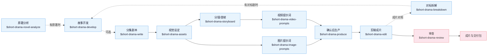
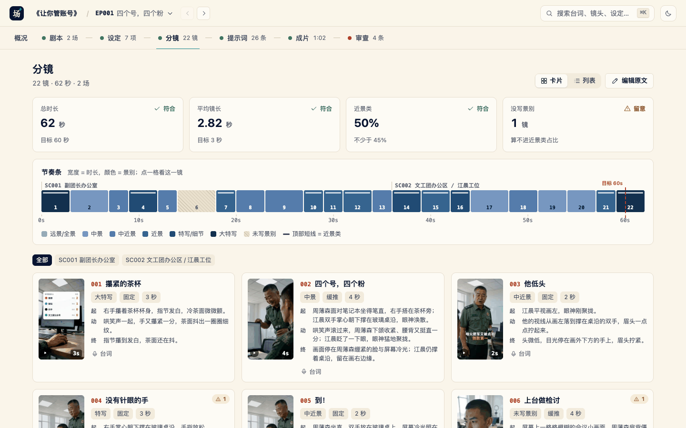

<p align="center">
  
</p>

<h1 align="center">Drama Skills</h1>

<p align="center">
  <b>面向编剧、漫剧工作室和编导的 AI 短剧创作工作流：十二个技能，从一个点子或一部原著做到分集剧本、分镜、图片/视频提示词和成片。</b>
</p>

<p align="center">
  <a href="https://zenstory.ai/zh/drama-skills"><b>项目主页</b></a>
  &nbsp;·&nbsp;
  <a href="#安装"><b>安装</b></a>
  &nbsp;·&nbsp;
  <a href="#看看它的输出"><b>看看它的输出</b></a>
  &nbsp;·&nbsp;
  <a href="README_EN.md"><b>English</b></a>
</p>

<p align="center">
  <a href="https://github.com/zenstory-ai/drama-skills/stargazers"></a>
  <a href="https://github.com/zenstory-ai/drama-skills/releases/latest"></a>
  
  <a href="https://www.python.org/"></a>
  <a href="https://github.com/zenstory-ai/drama-skills/actions/workflows/ci.yml"></a>
  <a href="./LICENSE"></a>
</p>

<p align="center">
  <a href="https://t.me/+CZmsmvWIhb4zZTNl"></a>
</p>

https://github.com/user-attachments/assets/640db65d-bd57-4924-83de-9c5852c1db26

上面这段 68 秒竖屏样片是《让你管账号》第 1 集开头：由一部 20 章小说改编，拆成 20 镜逐镜生成后剪成成片，字幕、系统面板与音效在剪辑阶段叠加。视频生成成本约 40 元。

### 更多样片：打戏、群戏、水墨漫剧

https://github.com/user-attachments/assets/f67e2e04-52e7-42a9-a4a0-e2864ff0f51e

## 这是什么

Drama Skills 覆盖 AI 短剧与漫剧从点子或原著到成片的全流程：**原著分析 → 分集剧本 → 视觉设定 → 图片提示词与分镜 → 视频提示词 → 确认后生产 → 剪辑成片 → 审查**。它以 12 个技能的形式装进你常用的编程 Agent（Claude Code、Codex 及其他支持 Agent Skill 规范的环境），直接使用当前 Agent 的模型写作。

这套技能脱胎于我们漫剧工作室的日常产线：2025 年以来累计做过上千个 AI 短剧和漫剧项目，近 8 万行代码的一体化图形工具跟不上模型迭代后，我们把工程做法和提示词经验提炼成这套技能，改用 Agent CLI 加纯文本文件管项目，内部工具只留排队生成。

- **五份 Markdown 记录创作决定** — 按阶段维护 `剧本.md`、`视觉设定.md`、`分镜.md`、`图片提示词.md`、`视频提示词.md`，剪辑时加一份 `剪辑单.md`；只做部分阶段就交付对应文档。
- **白纸黑字防跨镜穿帮** — 跨镜不变的穿着造型写成可原样贴入提示词的固定短语（连戏锁与锁定词），每镜首帧写明出场设定，检查脚本自动核对跨文档引用。
- **先看预览、确认后再花钱生成** — 图片、视频（支持单镜与 `GROUP-*` 多镜合生）、配音和配乐任务均支持整批预览，在文件里列清数量、内容、参考图与参数，明确确认后再批量调用外部接口；平台密钥留在项目外，文档与前置技能不绑定特定平台。
- **成片剪辑也在套件里** — 剪辑技能逐段写明入出点取舍，字幕逐字取自剧本，统一响度后导出成片；检查与测量脚本只列核对结果和实测数据，不替人做创作判断。

> **创作指导层与自动化脚本的边界**：各技能中的创作方法、剧本/分镜/提示词规范与审查视角不绑定语言、画幅或目录布局，可以直接用于任意语言或已有项目；本地自动化脚本（跨文档检查、创作台、生产交接与剪辑渲染）目前面向标准中文项目结构，要求使用上述五份中文文档与 `剪辑单.md` 的约定文件名及中文 Markdown 字段。

## 安装

前提：已在用 Claude Code、Codex 或其他支持 Agent Skill 规范的编程 Agent，终端可执行 `npx`（Node.js）。

```bash
npx skills add zenstory-ai/drama-skills -y -g
```

`-g` 为全局安装，去掉则只装到当前目录；**更新时重跑同一条命令即可**。带脚本的 7 个技能需要 **Python 3.9 或更高版本**（其余 5 个纯知识文档技能零运行依赖），剪辑成片另需安装 `ffmpeg` / `ffprobe`，启用可选 Remotion 画面文字或动态字幕叠层时另需 `Node.js` / `npm` / `npx`。

支持直接导入 GitHub 仓库的平台（如 WorkBuddy，见社区整理的[完整用法](https://zhuanlan.zhihu.com/p/2088046501696222384)），也可以直接对 Agent 说：

```
安装这些技能 https://github.com/zenstory-ai/drama-skills
```

<details>
<summary>手动软链安装（可安装全部，也可只链需要的技能）</summary>

```bash
git clone https://github.com/zenstory-ai/drama-skills.git && cd drama-skills

# Claude Code
mkdir -p "$HOME/.claude/skills"
for skill in skills/*; do
  ln -s "$PWD/$skill" "$HOME/.claude/skills/$(basename "$skill")"
done

# Codex
mkdir -p "${CODEX_HOME:-$HOME/.codex}/skills"
for skill in skills/*; do
  ln -s "$PWD/$skill" "${CODEX_HOME:-$HOME/.codex}/skills/$(basename "$skill")"
done
```

每个技能目录都可独立安装；只用某一项能力时软链对应目录即可。`short-drama` 负责项目初始化、阶段调度与本地创作台。

</details>

也可在 [ClawHub](https://clawhub.ai/) 中查找安装（清单见 [`.clawhub/publish.json`](.clawhub/publish.json)）。技能本身统一使用宿主中立的技能名（如 `short-drama`、`short-drama-write`），调用前缀随运行环境而变：Claude Code 用 `/short-drama`，Codex 用 `$short-drama`，其他支持 Agent Skill 规范的环境直接用技能名或自然语言描述任务；下文示例统一以 `$` 为例，按所用宿主替换或省略前缀即可。

> 版本变更见 [CHANGELOG.md](CHANGELOG.md) 与 [Releases](https://github.com/zenstory-ai/drama-skills/releases)；旧项目升级见[「升级到新版本后要做什么」](#升级到新版本后要做什么)。

## 快速开始

按实际项目修改下面的请求即可发送给 Agent：

```
# 0. 有原著时（可选）：先抽样快评，再决定要不要整本拆
用 $short-drama-novel-analyze 快评 输入/这本小说.txt，先告诉我值不值得拆

# 有对标剧或参考视频时（可选）：拆解节奏差距，或把成片视频反推成剧本与制作文档
用 $short-drama-breakdown 拆解 输入/对标/ 里的标杆剧并对照本项目节奏差距（也可直接把视频反推成标准《剧本.md》）

# 已有多集完整剧本时（可选）：先识别分集边界，逐集读取并续做分集大纲
用 $short-drama-develop 从 输入/剧本完整版.txt 生成分集大纲；先识别分集方式，不要整稿塞进上下文

# 1. 新建项目
用 $short-drama 初始化一个都市打脸题材的短剧项目，竖屏 9:16

# 2. 写第一集
用 $short-drama-write 写第 1 集：外卖员在高档餐厅被经理羞辱，亮出集团董事身份

# 3. 整理视觉设定，写提示词与分镜（可在同一条请求内连续完成）
用 $short-drama-assets 从第 1 集整理人物、场景和道具设定
需要统一全剧画风时，可选用 $short-drama 做视觉定调（Lookdev）
用 $short-drama-image-prompts 为已定稿的人物、场景和道具写参考图提示词
用 $short-drama-storyboard 给第 1 集拆分镜并写首帧提示词
用 $short-drama-video-prompts 把分镜逐镜写成视频提示词（同场相邻短镜可按需合并为 GROUP-* 多镜合生分组）
# 指定目标视频模型并要求跨镜一致时，一并说明参考图绑定方式：
用 $short-drama-video-prompts 按 MiniMax H3 写第 1 集视频提示词；先在项目里找已有角色图、场景图、道具图和本镜起始帧绑成参考，缺哪张列出来，不要改成文生视频
# 参考图在外部界面出、不进项目时，让技能写出逐镜挂图计划：
用 $short-drama-video-prompts 按 MiniMax H3 写第 1 集视频提示词；参考图我自己挂，逐镜写清挂哪几张、什么顺序、每张管什么

# 4. 明确确认后投产（支持单条或整批确认与断点续跑）
用 $short-drama-produce 批量预览第 1 集已定稿的图片、视频（含 GROUP-* 合生分组）、配音或配乐任务；等我确认后再执行

# 5. 剪成成片
用 $short-drama-edit 把第 1 集已生成的镜头剪成成片，逐段写清入出点理由

# 6. 按需审查
用 $short-drama-review 审查第 1 集的剧本与提示词
```

从小说原著起步、首轮只交文字稿时：

> 读一下 `输入/故事.txt`，先理出不能改的关键设定、人物动机和前期要藏住的悬念，再给出一套分集方案（别直接拿章节数当集数）。这轮只写第 1 集剧本，并挑三个关键镜头写清起止动作、手部姿态、持物和视线方向；先只交文字稿，不生图、生视频或配音。

## 看看它的输出

下面节选来自仓库样例与实测运行，省略处标为「……」。原著快评回填对照、设定兑现表、剪辑实测与模型摸底记录见[真实产出节选](docs/real-outputs.md)。

### 一集写出来是什么样

公开样例 [《让你管账号》EP001](examples/creator-first/EP001/) 中，同一个镜头在四份文档里各管一层。剧本只写戏剧动作与对白：

```markdown
[OS] 其他军团的人：火箭军？四个号，加起来四个粉吧。

笔记本的扬声器里一片哄笑。桌后，周薄森对着屏幕坐得笔直，脸绷着。桌前，江晨双手撑着桌沿，猛地回神。
```

`视觉设定.md` 给跨镜不变的穿着加上「连戏锁」，「锁定词」是可原样贴入提示词的固定短语：

```markdown
- 连戏锁：LOCK-JIANGCHEN-DRESS《江晨松枝绿常服》（镜头：SHOT-EP001-002、SHOT-EP001-003、SHOT-EP001-007、……；
  图片提示词项：IMG-JIANGCHEN-SHEET）· 锁定词：pine-green lapel service jacket
```

`分镜.md` 写明这一镜的起止画面与运镜动机；「首帧提示词」只画开场定格，原样带入锁定词：

```markdown
## SHOT-EP001-002 · 四个号，四个粉
- 运镜：缓推，哄笑声最响时开始，越过笔记本背面推向桌后，停在周薄森绷紧的脸；这阵笑是冲他去的。
- 起点：周薄森面对笔记本坐得笔直，右手搭在茶杯旁；江晨双手掌心朝下撑在玻璃桌沿，眼神涣散。
- 终点：画面停在周薄森绷紧的脸与屏幕冷光；江晨仍撑着桌沿，留在画右边缘。

### 首帧提示词
> 9:16 vertical two-person medium shot in a present-day army arts-troupe office, framed at chest height: Jiangchen, a lean
> young man in a pine-green lapel service jacket, stands mid-ground on frame right …… with both palms flat on the glass and a
> dazed, unfocused look; Zhoubosen, a broad square-faced middle-aged officer, sits bolt upright behind the desk …… facing a
> thin silver laptop whose lid faces the camera, …… his right hand beside a double-walled glass tea tumbler on a dark round
> coaster; …… no text, no logo.
```

`视频提示词.md` 只写起点到终点之间的动作推进与运镜，整段复制进生成界面就能用：

```markdown
## MOTION-EP001-002 · 四个号，四个粉
### 可复制提示词
> …… Laughter keeps pouring out of the laptop's small speaker. The seated officer's jaw tightens and his back straightens a
> little more. The young man blinks once and his eyes snap into focus. At the loudest point of the laughter, the camera moves
> steadily forward past the back of the laptop and stops when the seated officer's tight face fills the middle of the frame,
> the young man remaining at the right edge. ……
```

四份原文：[`剧本.md`](examples/creator-first/EP001/剧本.md) · [`视觉设定.md`](examples/creator-first/EP001/视觉设定.md) · [`分镜.md`](examples/creator-first/EP001/分镜.md) · [`视频提示词.md`](examples/creator-first/EP001/视频提示词.md)。

### 漏项和不一致会自动报错

`creator_markdown_check.py` 核对五份文档间的交叉引用。把样例故意改坏两处——从 SHOT-002 的「出场设定」里删掉周薄森、把 MOTION-003 的时长从 2 秒改成 3 秒——报错会直接指出问题镜头与修法：

```text
ERROR: SHOT-EP001-002: 首帧提示词写到人物「周薄森」，出场设定没有覆盖；本镜确实看不见时在出场设定末尾加「；画外：人物「周薄森」」，正文里这个名字不可靠时在《视觉设定.md》写「提示词名称：无」
ERROR: SHOT-EP001-003: 分镜时长 2 秒与视频提示词 3 秒不一致；视频提示词时长必须与分镜一致
```

## 十二个技能

各阶段按需调用：只出文字稿时写到目标阶段即可交付，任意现有文稿都可单独送审；静态漫剧可从首帧图片与配音直接进入生产和剪辑。



| 技能 | 职责 |
|---|---|
| `short-drama` | 项目初始化、阶段调度、视觉定调（Lookdev）与本地创作台 |
| `short-drama-novel-analyze` | 长篇原著抽样快评、章节索引、逐章梳理、脉络节奏分析与分集建议 |
| `short-drama-develop` | 原著改编、多集整稿切分与续拆、核心矛盾设定、分集大纲、导演阐述与题材钩子手册 |
| `short-drama-write` | 单集剧情目标、因果节点、可拍分集剧本与片场制作稿格式 |
| `short-drama-assets` | 人物与换装造型、场景与机位朝向、道具状态变化、角色声线及跨镜连戏锁 |
| `short-drama-image-prompts` | 视觉定调风格帧、角色/场景/道具参考图提示词与局部改图说明 |
| `short-drama-storyboard` | 场次站位调度与多机位比选、剧本逐句落镜、起止画面与首尾帧提示词 |
| `short-drama-video-prompts` | 单镜动作推进、多人调度与视线转移、运镜、声音、`GROUP-*` 多镜合生、补拍说明及跨镜配乐表 |
| `short-drama-produce` | 单条或整批预览图片/视频（含 `GROUP-*` 合生分组）/配音/配乐任务，明确确认后批量调用接口生成并支持断点续跑；内置支持 Seedance、GPT Image 2、MiniMax H3 / Speech / Music |
| `short-drama-edit` | 挑选单镜或 `GROUP-*` 合生素材可用区间、写明入出点取舍、核对台词、烧录字幕并统一响度，生成剪辑单与成片 |
| `short-drama-breakdown` | 按集长、镜长、对白密度、开场与集尾拆解对标剧并比对本项目差距；支持将参考剧集反推为剧本、设定与提示词 |
| `short-drama-review` | 结构与剧情审查；结合实拍出片效果排查设定与提示词偏差并给出修订建议 |

## 本地短剧创作台

在 Agent 里一句话启动（Codex 写作 `$short-drama dashboard`）：

```
/short-drama dashboard
```



原生支持 macOS、Linux、WSL 与 Windows。创作台默认在后台独立运行（`--detach`），会话期间链接持续有效；可用 `--status` 查看当前地址，`--stop` 关闭服务。服务仅监听本机，项目内容不上传。

完稿后可用 `project_tool.py export <project> --out <项目外目录>` 导出交付包，把每集现有的五份创作文档、`剪辑单.md` 与 `制作成果/` 汇总成带清单和校验和的目录；只交文本时加 `--no-media`。

## 常见问题

### 参考图在外部工具里生成、不放进项目目录，还能写图生视频提示词吗？

可以，这正是默认方式。项目里没有现成图片时，分镜会按出场人物、场景、道具和起始帧生成逐镜挂图计划，视频提示词照常按图生视频写出，并标明每镜挂哪几张图、按什么顺序挂、每张管什么；只有让套件直接调用接口生成时才需要把实图放进项目。详见[漫剧创作全流程指引](docs/comic-drama-workflow.md)。

### 视频生成提交后中断了，需要重投吗？

先找回原任务，避免重复扣费。内置生成接口拿到平台任务 ID 后会立即保存到本地；中断后先让 `$short-drama-produce` 运行 `audit` 定位未完结任务，再用 `collect` 取回已有结果。确认原任务已在平台侧失败且无结果可取后，再重新预览确认重投。详见[确认后生产](skills/short-drama-produce/SKILL.md)。

### 需要本地 GPU 吗？生图和生视频怎么计费？

不需要 GPU。剧本、分镜和提示词由你正在用的编程 Agent 模型完成，本地脚本负责索引、校验、任务交接与剪辑渲染（剪辑成片需本机装有 `ffmpeg` / `ffprobe`）。媒体生成使用你在项目外配置的平台密钥调用外部接口，按对应平台计费，每批任务都须预览确认后才执行。

### 静态漫剧（关键帧切换 + 配音）也要写视频提示词吗？

不用。分镜首帧与图片提示词可直接进入生产预览与配音剪辑，跳过视频提示词环节。完整串法见[漫剧创作全流程指引](docs/comic-drama-workflow.md)。

### 升级到新版本后要做什么？

重跑同一条安装命令即可更新技能。若旧项目跨越了字段或校验规则调整，按 [CHANGELOG.md](CHANGELOG.md) 中的升级说明修改文档后，对每集跑一次 `creator_markdown_check.py`（已剪辑剧集再跑一次 `edit_tool.py check`）核对即可。

## 致谢

<https://linux.do>

## ZenStory AI 项目

本项目由 [ZenStory AI](https://zenstory.ai/zh) 维护——一套开源的 AI 故事创作、改编与制作工具（GitHub 组织：[zenstory-ai](https://github.com/zenstory-ai)）。同组织项目：

| 项目 | 用途 |
| --- | --- |
| [oh-story-claudecode](https://github.com/zenstory-ai/oh-story-claudecode) | 网文写作技能包：扫榜、拆文、大纲细纲、长短篇写作、伏笔追踪、去 AI 味与封面生成 |
| [drama-skills](https://github.com/zenstory-ai/drama-skills) | AI 短剧与漫剧制作技能包：原著与对标拆解、剧本、视觉设定、分镜、生图/生视频提示词、确认后生产与剪辑成片（本仓库） |
| [novel-to-game](https://github.com/zenstory-ai/novel-to-game) | 小说改游戏技能包：通读拆书、玩法与美术设计、代码构建与盲玩验收，支持网页、互动影游与微信/抖音/TapTap 小游戏 |
| [video-recap-skills](https://github.com/zenstory-ai/video-recap-skills) | AI 视频解说技能包：自动切镜、看画面写解说词、配音混音合成硬字幕成片，并可导出剪映 / CapCut 草稿 |
| [oh-story-dsh](https://github.com/zenstory-ai/oh-story-dsh) | DeepSeek Harness 社区插件：集成网文写作、短剧漫剧、小说改游戏与视频解说四个可视化工作台 |
| [zenstory](https://github.com/zenstory-ai/zenstory) | 对话即创作的 AI 小说与短剧网页工作台（[app.zenstory.ai](https://app.zenstory.ai)） |
