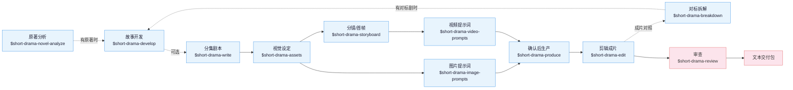
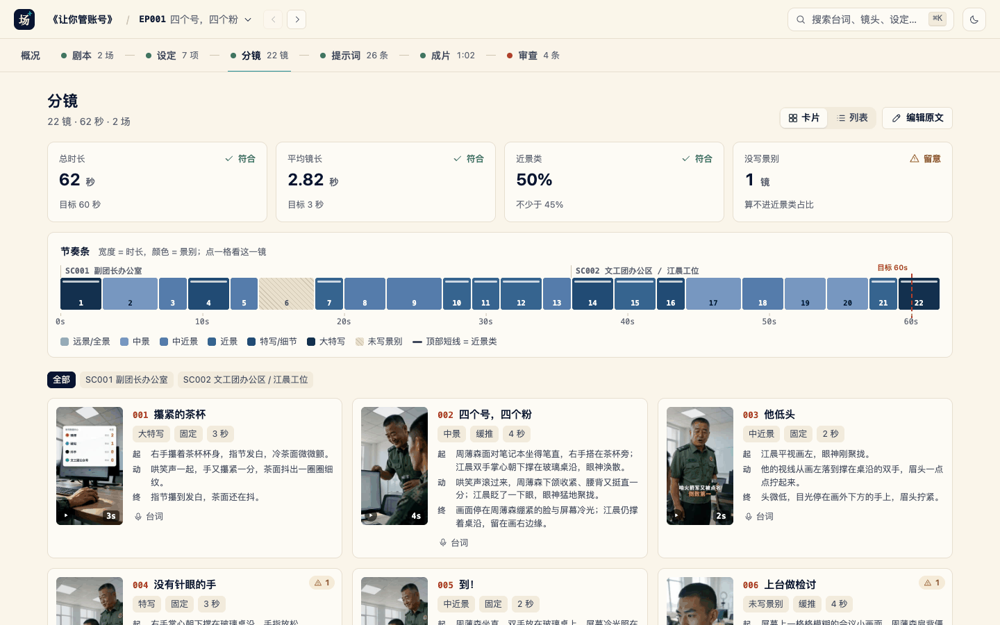

<p align="center">
  
</p>

<h1 align="center">Drama Skills</h1>

<p align="center">
  <b>面向编剧、漫剧工作室和编导的 AI 短剧创作工作流：十二个技能，从一个点子或一部原著做到分集剧本、分镜、图片/视频提示词和成片。</b>
</p>

<p align="center">
  <a href="https://zenstory.ai/zh/drama-skills"><b>项目主页</b></a>
  &nbsp;·&nbsp;
  <a href="#安装"><b>安装</b></a>
  &nbsp;·&nbsp;
  <a href="#看看它的输出"><b>看看它的输出</b></a>
  &nbsp;·&nbsp;
  <a href="README_EN.md"><b>English</b></a>
</p>

<p align="center">
  <a href="https://github.com/zenstory-ai/drama-skills/stargazers"></a>
  <a href="https://github.com/zenstory-ai/drama-skills/releases/latest"></a>
  
  <a href="https://www.python.org/"></a>
  <a href="https://github.com/zenstory-ai/drama-skills/actions/workflows/ci.yml"></a>
  <a href="./LICENSE"></a>
</p>

<p align="center">
  <a href="https://t.me/+CZmsmvWIhb4zZTNl"></a>
</p>

https://github.com/user-attachments/assets/640db65d-bd57-4924-83de-9c5852c1db26

上面这段 68 秒竖屏样片是《让你管账号》第 1 集开头：从一部 20 章的原著改编，分镜 20 镜，逐镜生成后剪成成片，
字幕、系统面板与音效在剪辑时叠加。视频生成成本约 40 元。

### 更多样片：打戏、群戏、水墨漫剧

https://github.com/user-attachments/assets/f67e2e04-52e7-42a9-a4a0-e2864ff0f51e

## 这是什么

Drama Skills 覆盖 AI 短剧 / 漫剧从点子或原著到成片的全流程：**原著分析 → 分集剧本 → 视觉设定 →
图片提示词与分镜 → 视频提示词 → 确认后生产 → 剪辑成片 → 审查**。
它以 12 个技能的形式装进你已经在用的编程 Agent（Claude Code、Codex 及其他支持 Agent Skill 规范的环境），
写作用的模型就是该 Agent 的模型。

- **五份 Markdown 分别记录创作决定** — 按阶段维护 `剧本.md`、`视觉设定.md`、`分镜.md`、`图片提示词.md`、
  `视频提示词.md`，剪成片时增加 `剪辑单.md`；只做部分阶段就交付对应文档。创作决定以这些文档为准。
- **靠白纸黑字的设定记录防穿帮** — 需要跨镜保持不变的穿着写成一条能原样贴进提示词的固定短语（连戏锁与锁定词）；
  每镜首帧都写明出场设定；检查脚本自动核对跨文档引用与连戏锁，报错示例见下文。
- **先看预览、明确确认，再花钱生成** — 任何图片、视频、配音或配乐任务，都先在文件里看清这一批准确的数量、内容和参数，
  明确确认后才调用外部接口。
- **成片剪辑也在套件里** — 剪辑技能逐段写下入点、出点为什么选在那里，字幕逐字取自剧本，统一响度后导出成片；
  检查和测量脚本只列核对结果和实测数据，不替人做创作判断。

## 由来

这套技能来自我们自己的漫剧工作室产线：2025 年至今累计上千个 AI 短剧 / 漫剧项目，
中间换过几轮自建和开源工具。前后端加起来近 8 万行代码，在模型能力和需求的迭代速度
面前逐渐维护不动了。

后来干脆抛开自建的一体化图形工具，把历史项目工程和图片 / 视频提示词蒸馏成这套技能，
让制作人直接用 Agent CLI 加文件维护工程、生成提示词，确认之后再送去生成——结果意外地顺手。
现在留在自建工具里的，只剩排队抽卡。

**刻意把确认放在生成之前**：提示词先落进文档，生产技能先把本次准确的数量、内容、参考图、
参数、输出路径和生成接口列出来；用户看过预览并明确确认后才执行。平台密钥留在项目之外，
项目文件和其他技能都不绑定特定平台。

## 安装

### 从 GitHub 安装

前提：你已经在用 Claude Code、Codex 或其他支持 Agent Skill 规范的编程 Agent；下面这条命令需要终端里能运行 `npx`（Node.js）。

```bash
npx skills add zenstory-ai/drama-skills -y -g
```

`-g` 全局安装，所有目录可用；去掉 `-g` 则只装到当前目录。**更新时重新执行同一条命令即可**。
脚本需要 **Python 3.9 或更新版本**，请先检查本机版本；剪辑成片另需 `ffmpeg` / `ffprobe` 在 PATH 上。

支持导入 GitHub 仓库或技能的平台（例如 WorkBuddy，见社区写的[完整用法](https://zhuanlan.zhihu.com/p/2088046501696222384)），也可以直接对 Agent 说：

```
安装这些技能 https://github.com/zenstory-ai/drama-skills
```

<details>
<summary>手动链接（可安装全部，也可只链接需要的技能）</summary>

```bash
git clone https://github.com/zenstory-ai/drama-skills.git && cd drama-skills

# Claude Code
mkdir -p "$HOME/.claude/skills"
for skill in skills/*; do
  ln -s "$PWD/$skill" "$HOME/.claude/skills/$(basename "$skill")"
done

# Codex
mkdir -p "${CODEX_HOME:-$HOME/.codex}/skills"
for skill in skills/*; do
  ln -s "$PWD/$skill" "${CODEX_HOME:-$HOME/.codex}/skills/$(basename "$skill")"
done
```

每个技能都是独立安装单元；只用剧本、审查或生成等单一能力时，只链接对应目录即可。
`short-drama` 提供项目初始化、阶段调度指引与本地创作台。

</details>

ClawHub 分发条目由[发布清单](.clawhub/publish.json)管理，可在 [ClawHub](https://clawhub.ai/) 中查找。

调用写法随运行环境而变：Claude Code 用 `/short-drama`，Codex 用 `$short-drama`，
也可以直接用自然语言说明任务。下文以 `$` 为例，Claude Code 用户按环境改用 `/`。

> 变更见 [CHANGELOG.md](CHANGELOG.md) 与 [Releases](https://github.com/zenstory-ai/drama-skills/releases)；
> 升级既有项目要做什么，见常见问题[「升级到新版本后要做什么」](#升级到新版本后要做什么)。

## 快速开始

按实际项目修改下面的请求即可使用：

```
# 0. 有原著时（可选）：先抽样快评，再决定要不要整本拆
用 $short-drama-novel-analyze 快评 输入/这本小说.txt，先告诉我值不值得拆

# 已有多集完整剧本时（可选）：先识别文件的分集结构，每次只读当前集，分段续做分集大纲
用 $short-drama-develop 从 输入/剧本完整版.txt 生成分集大纲；先识别这份文件的分集方式，不要整稿塞进上下文

# 1. 新建项目
用 $short-drama 初始化一个都市打脸题材的短剧项目，竖屏 9:16

# 2. 写第一集
用 $short-drama-write 写第 1 集：外卖员在高档餐厅被经理羞辱，亮出集团董事身份

# 3. 整理视觉设定，写提示词与分镜（可在同一请求内连续完成）
用 $short-drama-assets 从第 1 集整理人物、场景和道具设定
需要统一全剧画风时，可选用 $short-drama 做视觉定调（Lookdev）
用 $short-drama-image-prompts 为已定稿的人物、场景和道具写参考图提示词
用 $short-drama-storyboard 给第 1 集拆分镜并写首帧提示词
用 $short-drama-video-prompts 把分镜逐镜写成视频提示词
# 指定目标视频模型、并且要人物/场景/道具跨镜一致时，把参考图的事也说清楚：
用 $short-drama-video-prompts 按 MiniMax H3 写第 1 集视频提示词；先在项目里找已有的角色图、场景图、道具图和本镜起始帧绑成参考，缺哪张就列出来，不要改成文生视频
# 参考图在自己的界面里出、不进项目时，让技能写出逐镜挂图计划，视频提示词照常产出：
用 $short-drama-video-prompts 按 MiniMax H3 写第 1 集视频提示词；参考图我自己挂，逐镜告诉我挂哪几张、什么顺序、每张管什么

# 4. 明确确认后投产
用 $short-drama-produce 预览第 1 集已定稿的图片、视频、配音或配乐生成任务；等我确认后再执行

# 5. 把生产出来的素材剪成成片
用 $short-drama-edit 把第 1 集已生成的镜头剪成成片，逐段写清入出点理由

# 6. 需要时再审查
用 $short-drama-review 审查第 1 集的剧本与提示词
```

从原著出发、第一轮只出文字稿的写法：

> 用我有权改编的 `输入/故事.txt`，先理出不能改的原著关键设定、人物动机和暂时要先藏住的悬念，再给出一套分集方案，别直接拿章节数当集数。这轮只写第 1 集剧本，并挑其中三个镜头把开场和收尾动作、双手姿态、手里拿的东西和视线方向写清楚；分清哪些只有提示词、哪些参考图我自己挂、哪些图已经在项目里，先只出文字稿，别生图、生视频或配音。

## 看看它的输出

下面节选来自仓库里的文件或一次真实运行，省略处以「……」标出。完整版（原著快评回填对照、原著设定兑现表、
剪辑实测与模型实测记录）见[真实产出节选](docs/real-outputs.md)。

### 一集写出来是什么样

公开样例 [《让你管账号》EP001](examples/creator-first/EP001/) 里，同一个镜头在四份文档里各管一层。剧本只写发生了什么：

```markdown
[OS] 其他军团的人：火箭军？四个号，加起来四个粉吧。

笔记本的扬声器里一片哄笑。桌后，周薄森对着屏幕坐得笔直，脸绷着。桌前，江晨双手撑着桌沿，猛地回神。
```

`视觉设定.md` 给需要跨镜保持不变的穿着加上「连戏锁」，「锁定词」是一条能原样贴进提示词的固定短语：

```markdown
- 连戏锁：LOCK-JIANGCHEN-DRESS《江晨松枝绿常服》（镜头：SHOT-EP001-002、SHOT-EP001-003、SHOT-EP001-007、……；
  图片提示词项：IMG-JIANGCHEN-SHEET）· 锁定词：pine-green lapel service jacket
```

`分镜.md` 写这一镜的起点和终点、运镜为什么这样动；「首帧提示词」只画开场那一格，锁定词原样出现在里面：

```markdown
## SHOT-EP001-002 · 四个号，四个粉
- 运镜：缓推，哄笑声最响时开始，越过笔记本背面推向桌后，停在周薄森绷紧的脸；这阵笑是冲他去的。
- 起点：周薄森面对笔记本坐得笔直，右手搭在茶杯旁；江晨双手掌心朝下撑在玻璃桌沿，眼神涣散。
- 终点：画面停在周薄森绷紧的脸与屏幕冷光；江晨仍撑着桌沿，留在画右边缘。

### 首帧提示词
> 9:16 vertical two-person medium shot in a present-day army arts-troupe office, framed at chest height: Jiangchen, a lean
> young man in a pine-green lapel service jacket, stands mid-ground on frame right …… with both palms flat on the glass and a
> dazed, unfocused look; Zhoubosen, a broad square-faced middle-aged officer, sits bolt upright behind the desk …… facing a
> thin silver laptop whose lid faces the camera, …… his right hand beside a double-walled glass tea tumbler on a dark round
> coaster; …… no text, no logo.
```

`视频提示词.md` 只写起点到终点之间模型要执行的动作，整段复制进生成界面就能用：

```markdown
## MOTION-EP001-002 · 四个号，四个粉
### 可复制提示词
> …… Laughter keeps pouring out of the laptop's small speaker. The seated officer's jaw tightens and his back straightens a
> little more. The young man blinks once and his eyes snap into focus. At the loudest point of the laughter, the camera moves
> steadily forward past the back of the laptop and stops when the seated officer's tight face fills the middle of the frame,
> the young man remaining at the right edge. ……
```

四份原文：[`剧本.md`](examples/creator-first/EP001/剧本.md) ·
[`视觉设定.md`](examples/creator-first/EP001/视觉设定.md) ·
[`分镜.md`](examples/creator-first/EP001/分镜.md) ·
[`视频提示词.md`](examples/creator-first/EP001/视频提示词.md)。

### 写漏了会被指出来

`creator_markdown_check.py` 核对五份文档之间的引用。把样例故意改坏两处——删掉 SHOT-002 出场设定里的周薄森、
把 MOTION-003 的时长从 2s 改成 3s——报错会直接指出对应镜头和原因：

```text
ERROR: SHOT-EP001-002: 首帧提示词写到人物「周薄森」，出场设定没有覆盖；本镜确实看不见时在出场设定末尾加「；画外：人物「周薄森」」，正文里这个名字不可靠时在《视觉设定.md》写「提示词名称：无」
ERROR: SHOT-EP001-003: 分镜时长 2 秒与视频提示词 3 秒不一致；视频提示词时长必须与分镜一致
```

## 十二个技能

各阶段按需调用：只出文字稿时写到目标阶段即可交付，审查可针对任一现有文稿；静态漫剧从首帧图片与配音直接进入生成和剪辑。



| 技能 | 职责 |
|---|---|
| `short-drama` | 项目初始化、阶段调度指引、视觉定调（Lookdev）与本地创作台 |
| `short-drama-novel-analyze` | 长篇原著抽样改编快评、章节索引、逐章情节梳理、故事脉络与节奏分析、改编价值评估与分集方案建议 |
| `short-drama-develop` | 有据可查的原著改编、多集整稿切分与分段续拆、核心矛盾设定、分集大纲、导演阐述、题材与钩子手册 |
| `short-drama-write` | 单集剧情目标、前因后果与情节节点、可拍剧本及所选片场制作稿格式 |
| `short-drama-assets` | 人物与换装造型、场景与机位朝向、道具与状态变化、角色声线与配音设定、跨镜防穿帮连戏锁 |
| `short-drama-image-prompts` | 视觉定调（Lookdev）风格帧、角色/场景/道具参考图提示词与局部修改说明 |
| `short-drama-storyboard` | 可选场次调度设计与多套机位比选、剧本逐句落镜、起止画面与首尾帧提示词 |
| `short-drama-video-prompts` | 单镜动作过程、多人同框表演与视线焦点转移、运镜、声音、起止状态、补拍说明，以及跨镜配乐时间表 |
| `short-drama-produce` | 预览范围明确的图片/视频/配音/配乐生成任务，经创作者明确确认后调用对应生成接口执行并记录结果；内置支持 Seedance、GPT Image 2、MiniMax H3 视频与 MiniMax Music |
| `short-drama-edit` | 挑选每条生成素材的可用片段区间、写明入出点取舍与镜序、核对台词完整性、叠加字幕并统一响度，生成剪辑单并导出成片 |
| `short-drama-breakdown` | 测量并拆解对标剧的集长、镜长、对白密度、开场与集尾，与本项目的计划或成片同口径比出差距，交回对应技能调整并用成片复核；也可把参考剧集反推还原成剧本、设定与提示词 |
| `short-drama-review` | 结构与剧情质量审查；结合实际出片效果排查整部剧的设定与提示词偏差，给出修改建议 |

## 本地短剧创作台

在智能体里一句话启动（Codex 写作 `$short-drama dashboard`）：

```
/short-drama dashboard
```



macOS、Linux、WSL 与 Windows 原生都可运行。创作台以 `--detach` 独立进程运行，链接在整个创作期间
保持有效；`--status` 打印当前链接，`--stop` 关闭。服务只监听本机，项目内容不上传。

全部跑完后导出交付：`$short-drama` 用 `project_tool.py export <project> --out <项目外目录>`
把每集现有的五份创作文档、`剪辑单.md` 和 `制作成果/` 复制成带清单和校验和的交付目录。
只交文本时加 `--no-media`；缺少哪些创作文档会记在清单里。

## 常见问题

### MiniMax H3 的提示词有六段，全部复制还是只复制第一段？

全部复制。六段属于**同一条正文、一次提交**：`retention_analysis` 引用的 `<Subject N>` 在 `subject_definitions` 里定义，
`<Picture N>` 按本镜「输入参考图」的顺序编号，拆开提交后面几段就没有指代对象了。从 `### 可复制提示词` 下第一行到最后一行
整段贴进那一次生成，下一镜换它自己那条。见[五份创作文档](skills/short-drama/references/creator-documents.md)与
[MiniMax H3 提示词写法](skills/short-drama-video-prompts/references/minimax-h3.md)。

### 参考图我在自己的界面里出、不想放进项目，还能拿到图生视频提示词吗？

能，这就是默认做法。项目里找不到现成图片时，分镜会把这一镜要挂的图写成 `PLAN-*` 挂图位置（指明对应哪条 `IMG-*` 设定图或哪一镜 `SHOT-*` 首帧，支持正反打等跨镜复用同一首帧，`顺序` 就是挂图次序，
每张写明用途），视频提示词照常按图生视频产出，并逐镜列出挂哪几张、什么顺序、每张管什么；只有让套件直接调用接口生成时才需要本地实图。
`REF-*` 留给项目里确实存在并核对过的图片。

### 指定了目标视频模型，为什么收到的是文生视频提示词？

点名模型不等于选择文生视频。先把模型写进 `short-drama.json` 的 `production_profile`，再让分镜按出场人物、地点、道具和起始帧
去项目里找已有的图绑成带用途的 `REF-*`；仍缺的图默认写成 `PLAN-*` 挂图计划、照常产出图生视频提示词，不改成文生视频。见
[漫剧创作全流程指引 · 常见卡点](docs/comic-drama-workflow.md#常见卡点)。

### H3 视频里对白赶读或被截断怎么办？

分镜阶段先估对白时长再定镜长：H3 中文小样本实测约每秒 4.1 个发音字，台词塞太密容易赶词，或者不报错直接截断。分镜定镜长时先估清台词加动作是否放得下（「声音」字段只写干净的台词、画外音与音效，不塞估时算式），
放不下就拉长镜头或拆成两镜；视频提示词时长必须与分镜保持一致。见[对白估时](skills/short-drama-storyboard/references/shot-craft.md#对白估时)。

### 说话的是 A，口型却落在画里 B 的脸上？

先检查说话人绑定：小样本中出现过口型落在更显眼正脸上的情况。说话人第一次出现时在 `<d>` 外交代画内画外与音色，台词紧跟他的动作句；
台词期间画里还有别的正脸时，把那个人明写成闭嘴不说话，分镜能安排时先让他出画或背身。见
[MiniMax H3 提示词写法 · 对白与说话人绑定](skills/short-drama-video-prompts/references/minimax-h3.md#对白说话人绑定与参考音频)；样本小，生成后仍需核对。

### 视频任务提交后进程断了，要重投吗？

先找回原任务。异步任务提交后可能已经扣费，内置生成接口拿到平台任务 ID 就会立刻写入本地文件。中断后先让生产技能运行 `audit`；
它会把带有任务 ID 但中断未完的记录标为 `orphaned_provider_job`，再用 `collect` 取回已有结果，不会重复提交新任务。
确认原任务已经彻底失败、没有结果可取回后，再重新预览和确认重投；若只是轮询或下载中断，先排查取回环节。见
[确认后生产](skills/short-drama-produce/SKILL.md)。

### 需要 GPU 或自己部署模型吗？生成媒体的钱从哪出？

不需要 GPU。写作、分镜和提示词由你正在用的编程 Agent 的模型完成，本地脚本负责索引、检查、生成任务交接与剪辑渲染。生成媒体走 `$short-drama-produce`
的外部生成接口，使用你在项目外配置好的平台密钥、按平台计费，每个任务先看预览并明确确认后才执行。剪辑成片需要本机装有 `ffmpeg` / `ffprobe`。

### 能在 Codex 里用吗？Windows 能用吗？

能。Claude Code 用 `/short-drama`，Codex 用 `$short-drama`，其他支持 Agent Skill 规范的环境按各自写法调用。
创作台在 macOS、Linux、WSL 与 Windows 原生都能跑；CI 在 Windows 上单独回归安装、分集导入与创作台。

### 静态漫剧（关键帧切换 + 配音）也要写视频提示词吗？

不用。分镜首帧与图片提示词直接进入生产预览，跳过视频提示词环节。见[漫剧创作全流程指引](docs/comic-drama-workflow.md)。

### 升级到新版本后要做什么？

重跑同一条安装命令；既有项目对每集跑一次 `creator_markdown_check.py`，新收紧的文档规则会在这里报出来（例如「首帧提示词」「尾帧提示词」或文生视频「开场画面」点到的人物、地点、道具没写进「出场设定」也没注明画外会报错，
视频提示词与分镜时长不一致也会报错），字段变更与改法见 [CHANGELOG.md](CHANGELOG.md) 里的升级说明。剪过片的再跑一次 `edit_tool.py check`：
v0.7.1 起「未采用镜头」要逐个写镜号和理由，「001 至 009」这种范围写法不再支持。

## 延伸阅读

- 示例：[examples/](examples/)，公开完整样例是 [《让你管账号》EP001](examples/creator-first/EP001/)；其余目录是供校验脚本自测的内部样例。
- [真实产出节选](docs/real-outputs.md)：一镜穿过四份文档、检查器报错、剪辑单与实测、原著快评回填、原著设定兑现表、模型实测记录。
- [评估](evaluations/README.md)：按文档实跑一次的完整产物、发版前的验收检查项与主工作流实跑方法。
- [漫剧创作全流程指引](docs/comic-drama-workflow.md)：把十二个技能按漫剧产线从头串一遍，每步命令、产物与卡点。
- [跨镜一致性怎么做](docs/character-consistency-across-shots.md)：跨镜、跨集防穿帮做法，三视图之外的三道文字记录。
- [短剧剧本格式模板](docs/short-drama-script-format-template.md)：场景标题、动作、对白和制作标签怎么分，用 AI 整理旧稿后查什么。
- [分镜脚本怎么写](docs/short-drama-storyboard-script-template.md)：短剧分镜表模板，把剧本逐镜拆开。
- [角色三视图提示词怎么写](docs/character-turnaround-sheet-prompts.md)：三视图模板、范例与常见失误。
- [Seedance 提示词怎么写](docs/seedance-prompt-writing.md)：起点、动作顺序、终点，以及 2.5 与 2.0 的写法差别。
- [开源 AI 短剧 / 漫剧工具怎么选](docs/open-source-ai-short-drama-tools.md)：9 个项目按使用方式、许可证、覆盖环节与跨镜一致性做法对比（含利益相关说明）。
- [小说改短剧指南](https://zenstory.ai/zh/drama-skills/novel-to-short-drama)：从有权改编的原著出发，形成分集决策、单集剧本与小范围分镜交接。
- [角色跨镜一致性指南](https://zenstory.ai/zh/drama-skills/character-consistency)：分清人物外貌、本场穿着与逐镜变化的双手、持物、视线；理顺提示词、待挂图与本地实图的分工。
- [An open-source AI short-drama pipeline](docs/open-source-short-drama-pipeline.md)：英文读者的分阶段说明。

## 交流

- **Telegram 群**：<https://t.me/+CZmsmvWIhb4zZTNl> —— 日常交流、踩坑、用法分享与新功能讨论。
- **GitHub Issues**：[Bug、输出质量 Case、功能请求](https://github.com/zenstory-ai/drama-skills/issues/new/choose)，请按结构化表单附上复现材料或具体输出。

## 贡献

修改原则与必跑测试见 [CONTRIBUTING.md](CONTRIBUTING.md)。

<a href="https://github.com/zenstory-ai/drama-skills/graphs/contributors"></a>

## 致谢

[LINUX DO - The New Ideal Community](https://linux.do) — 社区支持

## ZenStory AI 项目

本项目由 [ZenStory AI](https://zenstory.ai/zh) 维护——一套开源的 AI 故事创作、改编与制作工具（GitHub 组织：[zenstory-ai](https://github.com/zenstory-ai)）。同组织项目：

| 项目 | 用途 |
| --- | --- |
| [oh-story-claudecode](https://github.com/zenstory-ai/oh-story-claudecode) | 网文写作 skill 包：扫榜、拆文、写作、去AI味、封面图 |
| [drama-skills](https://github.com/zenstory-ai/drama-skills) | AI 短剧 / 漫剧创作 skill 合集：剧本、视觉设定、分镜、图片/视频提示词、独立审查（本仓库） |
| [novel-to-game](https://github.com/zenstory-ai/novel-to-game) | 小说改编游戏 skill 合集：原著拆解、目标运行环境构建与实机运行验收 |
| [video-recap-skills](https://github.com/zenstory-ai/video-recap-skills) | 将支持的视频文件制作成中文解说，可选导出可编辑的剪映/CapCut 草稿 |
| [oh-story-dsh](https://github.com/zenstory-ai/oh-story-dsh) | DeepSeek Harness 社区插件，提供小说、短剧、游戏和视频解说工作台 |
| [zenstory](https://github.com/zenstory-ai/zenstory) | 对话即创作的 AI 小说写作工作台（[app.zenstory.ai](https://app.zenstory.ai)） |
