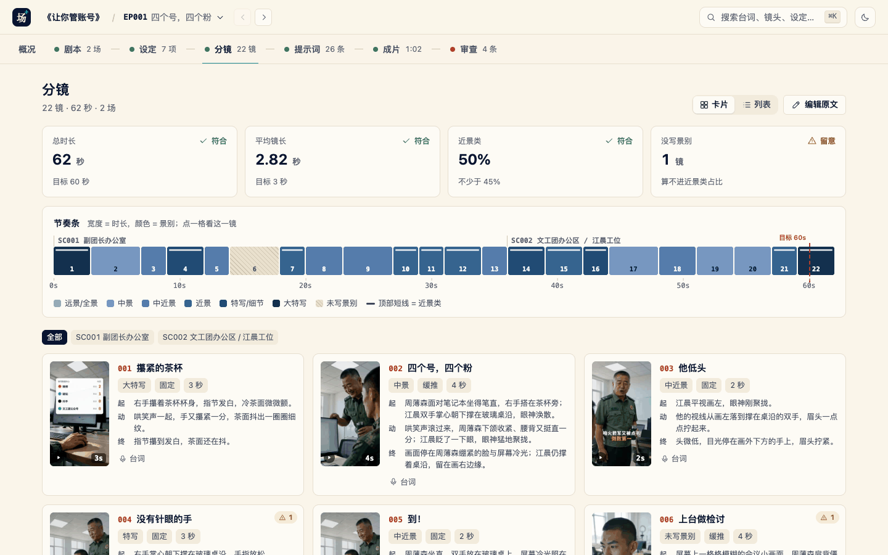

<!-- Last synced with README.md: 2026-11-21 -->

<p align="center">
  
</p>

<h1 align="center">Drama Skills</h1>

<p align="center">
  <b>An AI short-drama creation workflow for screenwriters, motion-comic studios, and directors: twelve skills that take an idea or a source novel to episode scripts, storyboards, image/video prompts, and a finished cut.</b>
</p>

<p align="center">
  <a href="https://zenstory.ai/drama-skills"><b>Project page</b></a>
  &nbsp;·&nbsp;
  <a href="#install"><b>Install</b></a>
  &nbsp;·&nbsp;
  <a href="#see-what-it-produces"><b>See what it produces</b></a>
  &nbsp;·&nbsp;
  <a href="README.md"><b>中文</b></a>
</p>

<p align="center">
  <a href="https://github.com/zenstory-ai/drama-skills/stargazers"></a>
  <a href="https://github.com/zenstory-ai/drama-skills/releases/latest"></a>
  
  <a href="https://www.python.org/"></a>
  <a href="https://github.com/zenstory-ai/drama-skills/actions/workflows/ci.yml"></a>
  <a href="./LICENSE"></a>
</p>

<p align="center">
  <a href="https://t.me/+CZmsmvWIhb4zZTNl"></a>
</p>

https://github.com/user-attachments/assets/640db65d-bd57-4924-83de-9c5852c1db26

The 68-second vertical sample above is the opening of *Let You Run the Account* EP001: adapted from a 20-chapter novel into 20 shots, generated shot by shot and cut into a finished episode with subtitles, system panels, and sound effects added in the edit. Video generation cost about ¥40.

### More samples: a fight, an ensemble scene, a 2D ink-wash comic

https://github.com/user-attachments/assets/f67e2e04-52e7-42a9-a4a0-e2864ff0f51e

## What it is

Drama Skills covers the AI short-drama and motion-comic pipeline from idea or source novel to finished cut: **source analysis → episode script → visual design → image prompts and storyboard → video prompts → confirmed production → editing → review**. It installs as 12 skills into the coding agent you already use (Claude Code, Codex, or any runtime supporting the Agent Skill spec) and writes with that agent's model.

These skills grew out of our motion-comic studio's production line: after more than a thousand AI short-drama and motion-comic projects since 2025, a nearly 80,000-line all-in-one GUI could no longer keep up with model iteration, so we distilled our workflows and prompt craft into plain-file agent skills and kept only the generation queue in-house.

- **Five Markdown files record creative decisions** — each episode maintains the files its stages need: `剧本.md` (script), `视觉设定.md` (visual design), `分镜.md` (storyboard), `图片提示词.md` (image prompts), and `视频提示词.md` (video prompts), plus `剪辑单.md` (cut list) when editing.
- **Written settings keep shots consistent** — any look that must hold across shots gets a continuity lock with a fixed phrase pasted verbatim into prompts, every first-frame prompt declares its on-screen settings, and a checker verifies cross-file references.
- **Preview and confirm before spending money** — image, video (single shots or `GROUP-*` multi-shot groups), voice, and music jobs can be previewed as a batch first, listing exact counts, prompts, references, and parameters before calling external APIs; API keys stay outside the project and upstream files stay provider-neutral.
- **Editing is part of the suite** — the editing skill records the reason for every in and out point, pulls subtitles verbatim from the script, normalizes loudness, and renders the episode; check and measurement scripts report objective results without making creative calls for you.

> **Language-agnostic creative guidance vs. automated scripts**: The creative workflows, craft guides, prompt-writing methods, and review rubrics are language- and layout-agnostic—you can use them in English or any other language, aspect ratio, or existing directory structure without running local scripts. The bundled automated scripts (cross-document checks, local creator workspace, production handoff, and edit rendering) currently expect the standard Chinese five-document filenames (`剧本.md`, `视觉设定.md`, `分镜.md`, `图片提示词.md`, `视频提示词.md`), `剪辑单.md`, and their Chinese Markdown field structure.

## Install

Prerequisite: Claude Code, Codex, or another coding agent supporting the Agent Skill spec, with `npx` (Node.js) available in your terminal.

```bash
npx skills add zenstory-ai/drama-skills -y -g
```

`-g` installs globally (omit it to install into the current directory only); **re-run the same command to update**. The 7 script-backed skills require **Python 3.9 or newer** (the other 5 documentation-only skills have no runtime prerequisites), rendering an edited cut also needs `ffmpeg` / `ffprobe` on `PATH`, and optional Remotion screen-text or dynamic-subtitle overlays additionally need `Node.js` / `npm` / `npx`.

On platforms that import skills directly from a GitHub URL (such as WorkBuddy; see the [community walkthrough](https://zhuanlan.zhihu.com/p/2088046501696222384) in Chinese), you can tell your agent:

```
Install this skill suite: https://github.com/zenstory-ai/drama-skills
```

<details>
<summary>Manual symlink install (all skills, or only the ones you need)</summary>

```bash
git clone https://github.com/zenstory-ai/drama-skills.git && cd drama-skills

# Claude Code
mkdir -p "$HOME/.claude/skills"
for skill in skills/*; do
  ln -s "$PWD/$skill" "$HOME/.claude/skills/$(basename "$skill")"
done

# Codex
mkdir -p "${CODEX_HOME:-$HOME/.codex}/skills"
for skill in skills/*; do
  ln -s "$PWD/$skill" "${CODEX_HOME:-$HOME/.codex}/skills/$(basename "$skill")"
done
```

Each skill directory is standalone; link only the directories you need. `short-drama` provides project setup, stage routing, and the local creator workspace.

</details>

Skills are also listed on [ClawHub](https://clawhub.ai/) (manifest: [`.clawhub/publish.json`](.clawhub/publish.json)). The skills themselves use host-neutral skill names (such as `short-drama` and `short-drama-write`), while invocation prefixes differ by runtime: Claude Code uses `/short-drama`, Codex uses `$short-drama`, and other Agent Skill runtimes accept the plain skill name or natural language; examples below use `$`, so adapt or omit the prefix for your runtime.

> Release notes are in [CHANGELOG.md](CHANGELOG.md) and [Releases](https://github.com/zenstory-ai/drama-skills/releases); for existing projects, see [What do I do after upgrading?](#what-do-i-do-after-upgrading).

## Quick start

Adapt any of these prompts to your project and send it to your agent:

```
# 0. With a source novel (optional): sample triage before committing to a full pass
Use $short-drama-novel-analyze to triage 输入/novel.txt and tell me whether it is worth adapting

# With benchmark dramas or reference videos (optional): measure pacing gaps, or reverse-engineer video into scripts and docs
Use $short-drama-breakdown to benchmark 输入/对标/ against this project (or reverse-engineer a reference video directly into a standard 剧本.md)

# With a complete multi-episode script (optional): detect episode boundaries and build the outline incrementally
Use $short-drama-develop to build the episode outline from 输入/full-screenplay.txt; detect episode boundaries first without loading the whole script into context

# 1. New project
Use $short-drama to init a vertical 9:16 urban face-slapping short-drama project

# 2. Write episode 1
Use $short-drama-write to write EP001: a delivery rider humiliated by the manager at a luxury restaurant reveals he is a director of the group

# 3. Organize visual design, write prompts and storyboards (can run in a single request)
Use $short-drama-assets to organize character, location, and prop settings from EP001
When the overall visual style needs alignment, optionally use $short-drama for Look Development
Use $short-drama-image-prompts to write reference prompts for finalized characters, locations, and props
Use $short-drama-storyboard to break EP001 into shots and write first-frame prompts
Use $short-drama-video-prompts to turn each shot into a video prompt (optionally grouping short adjacent shots into GROUP-* multi-shot prompts)
# When targeting a specific video model with cross-shot consistency, state how references are bound:
Use $short-drama-video-prompts to write EP001's video prompts for MiniMax H3; bind existing character, location, prop, and start-frame images in the project, list any missing ones, and do not fall back to text-to-video
# When reference images are generated externally and stay out of the project, ask for a per-shot attach plan:
Use $short-drama-video-prompts to write EP001's video prompts for MiniMax H3; I attach the reference images myself, so list per shot which images to attach, in what order, and what each governs

# 4. Produce after explicit confirmation (single or batched, with resume support)
Use $short-drama-produce to preview a batch of EP001's finalized image, video (including GROUP-* groups), voice, or music jobs; execute only after I confirm

# 5. Cut into a finished episode
Use $short-drama-edit to cut EP001's produced shots into an episode, stating the reason behind every in and out point

# 6. Review on demand
Use $short-drama-review to review EP001's script and prompts
```

Starting from a source novel when the first pass only needs text drafts:

> Read `输入/story.txt`, list the core settings that must stay intact, character motivations, and reveals to hold back early on, then propose an episode breakdown rather than mapping one chapter per episode. For this pass, write EP001's script only and detail three key shots with start/end actions, hand poses, held props, and eyelines; deliver text drafts only without generating images, video, or audio.

## See what it produces

The excerpts below come from files in this repository and real runs ("…" marks cuts). For the full set—source triage vs. full-pass comparison, setting payoff checklist, measured cut list, and model probes—see [Excerpts of real output](docs/real-outputs_EN.md).

### What an episode looks like

In the public sample [*Let You Run the Account*, EP001](examples/creator-first/EP001/), one shot is handled layer by layer across four documents. The script records only dramatic action and dialogue (translated):

```markdown
[OS] Someone from another army unit: The Rocket Force? Four accounts, four followers between them, right?

Laughter pours out of the laptop's speaker. Behind the desk, Zhou Bosen sits bolt upright facing the screen, face set.
In front of it, Jiang Chen, palms on the desk edge, snaps back to himself.
```

`视觉设定.md` (visual design) gives any look that must hold across shots a **continuity lock**, whose **locked phrase** pastes into prompts unchanged (translated):

```markdown
- Continuity lock: LOCK-JIANGCHEN-DRESS "Jiang Chen's pine-green service uniform" (shots: SHOT-EP001-002, SHOT-EP001-003, SHOT-EP001-007, …;
  image prompt entry: IMG-JIANGCHEN-SHEET) · locked phrase: pine-green lapel service jacket
```

`分镜.md` (storyboard) sets the shot's start, end, and camera motivation; the **first-frame prompt** draws the opening frame alone, carrying the locked phrase verbatim (translated; prompt quoted as written):

```markdown
## SHOT-EP001-002 · Four accounts, four followers
- Camera: slow push-in, starting at the loudest point of the laughter, past the back of the laptop toward the desk, stopping
  on Zhou Bosen's set face; the laughter is aimed at him.
- Start: Zhou Bosen sits bolt upright facing the laptop, right hand beside his tea tumbler; Jiang Chen's palms rest flat on
  the glass edge, his eyes unfocused.
- End: the frame settles on Zhou Bosen's set face in the screen glow; Jiang Chen still leans on the desk at the right edge.

### First-frame prompt
> 9:16 vertical two-person medium shot in a present-day army arts-troupe office, framed at chest height: Jiangchen, a lean
> young man in a pine-green lapel service jacket, stands mid-ground on frame right … with both palms flat on the glass and a
> dazed, unfocused look; Zhoubosen, a broad square-faced middle-aged officer, sits bolt upright behind the desk … facing a
> thin silver laptop whose lid faces the camera, … his right hand beside a double-walled glass tea tumbler on a dark round
> coaster; … no text, no logo.
```

`视频提示词.md` (video prompts) writes only the motion and camera move from start to end, ready to paste as one block:

```markdown
## MOTION-EP001-002 · Four accounts, four followers
### Copyable prompt
> … Laughter keeps pouring out of the laptop's small speaker. The seated officer's jaw tightens and his back straightens a
> little more. The young man blinks once and his eyes snap into focus. At the loudest point of the laughter, the camera moves
> steadily forward past the back of the laptop and stops when the seated officer's tight face fills the middle of the frame,
> the young man remaining at the right edge. …
```

The four originals: [`剧本.md`](examples/creator-first/EP001/剧本.md) · [`视觉设定.md`](examples/creator-first/EP001/视觉设定.md) · [`分镜.md`](examples/creator-first/EP001/分镜.md) · [`视频提示词.md`](examples/creator-first/EP001/视频提示词.md).

### Missing entries and mismatches are flagged

`creator_markdown_check.py` follows a **soft-gate principle**: only 100% deterministic mechanical checks (dangling cross-document IDs, missing asset files, duration mismatches, malformed slot syntax) emit blocking `ERROR`s, while heuristic checks emit non-blocking `WARNING`s for the agent to review. Breaking the sample in two places—misspelling `周薄森` as `周博森` in SHOT-002's on-screen settings (`出场设定`) and changing MOTION-003's duration from 2s to 3s—produces targeted errors:

```text
ERROR: SHOT-EP001-002: 出场设定指向不存在的《视觉设定.md》条目: 人物「周博森」
ERROR: SHOT-EP001-003: 分镜时长 2 秒与视频提示词 3 秒不一致；视频提示词时长必须与分镜一致
```

Line 1 flags that `出场设定` references a character name (`周博森`) that does not exist in `视觉设定.md`. Line 2 catches a duration mismatch between the 2-second storyboard shot and the 3-second video prompt.

## The twelve skills

Invoke only the stages you need: text-only handoffs can stop at any stage, any existing draft can be reviewed on its own, and static motion comics go straight from first-frame images and voice-over to production and editing.

```mermaid
flowchart LR
    classDef phase fill:#e8f4fd,color:#1a1a2e,stroke:#4a9be8,stroke-width:1px
    classDef final fill:#fce4ec,color:#333,stroke:#e57373,stroke-width:1px

    nva["Source analysis<br/>$short-drama-novel-analyze"]:::phase
    brk["Benchmark breakdown<br/>$short-drama-breakdown"]:::phase
    dev["Story development<br/>$short-drama-develop"]:::phase
    write["Episode script<br/>$short-drama-write"]:::phase
    assets["Visual design<br/>$short-drama-assets"]:::phase
    img["Image prompts<br/>$short-drama-image-prompts"]:::phase
    sb["Storyboard/first frames<br/>$short-drama-storyboard"]:::phase
    vid["Video prompts<br/>$short-drama-video-prompts"]:::phase
    prod["Confirmed production<br/>$short-drama-produce"]:::phase
    cut["Editing<br/>$short-drama-edit"]:::phase
    rev["Review<br/>$short-drama-review"]:::final
    pkg["Final cut & delivery package"]:::final

    nva -.with a source.-> dev
    brk -.with benchmarks.-> dev
    cut -.compare cuts.-> brk
    dev -.optional.-> write --> assets
    assets --> img
    assets --> sb --> vid
    img --> prod
    vid --> prod
    prod --> cut --> rev --> pkg
```



| Skill | Responsibility |
|---|---|
| `short-drama` | Project setup, stage routing, visual direction / Lookdev, and the local creator workspace |
| `short-drama-novel-analyze` | Sampled adaptation triage, chapter indexing, per-chapter extraction, pacing analysis, and episode split proposals |
| `short-drama-develop` | Source adaptation, multi-episode script slicing and resume, core conflict setup, episode outlines, director's brief, and genre/hook playbooks |
| `short-drama-write` | Episode goals, cause-and-effect beats, shootable screenplays, and studio script formatting |
| `short-drama-assets` | Characters and wardrobe variants, locations and camera angles, prop state changes, voice notes, and continuity locks |
| `short-drama-image-prompts` | Lookdev style frames, character/location/prop reference prompts, and targeted image edits |
| `short-drama-storyboard` | Scene staging and multi-angle comparisons, script-to-shot breakdown, start/end frames, and first/end-frame prompts |
| `short-drama-video-prompts` | Single-shot motion, multi-character staging and eyeline shifts, camera moves, sound, `GROUP-*` multi-shot groups, pickup notes, and cross-shot music cues |
| `short-drama-produce` | Preview single or batched image/video (including `GROUP-*` groups)/voice/music jobs, run provider APIs after explicit confirmation with resume support, and archive outputs; built-in profiles for Seedance, OpenAI GPT Image, and MiniMax H3 / Speech / Music |
| `short-drama-edit` | Select usable ranges from single shots or `GROUP-*` clips, record in/out rationale, verify dialogue, burn subtitles, normalize loudness, and render finished episodes |
| `short-drama-breakdown` | Measure benchmark dramas (episode/shot length, dialogue density, hooks/cliffhangers) against your project; reverse-engineer reference episodes into scripts, settings, and prompts |
| `short-drama-review` | Structural and dramatic quality review; project-wide calibration and revision advice from real generated outputs |

## Local creator workspace

Launch with one line inside your agent (Codex writes `$short-drama dashboard`):

```
/short-drama dashboard
```



Runs natively on macOS, Linux, WSL, and Windows. The server runs in the background with `--detach` so its link stays live across your session; `--status` prints the active URL and `--stop` shuts it down. It listens on loopback only and never uploads project files.

When ready to hand off, `project_tool.py export <project> --out <dir-outside-project>` packages each episode's existing five creator documents, `剪辑单.md`, and `制作成果/` into a delivery directory with a manifest and checksums; pass `--no-media` for a text-only handoff.

## FAQ

### Can I still get image-to-video prompts if I generate reference images in an external tool?

Yes—that is the default workflow. When reference images are not stored in the project directory, the storyboard writes a per-shot attachment plan and video prompts are still generated for image-to-video, listing which images to attach per shot, in what order, and what each governs; local image files are only needed when `$short-drama-produce` calls a provider API directly. See the [Comic-drama workflow guide](docs/comic-drama-workflow.md) (Chinese).

### A video job was interrupted after submission. Should I resubmit it?

Recover the existing job first to avoid paying twice. Bundled provider adapters write each job ID to disk as soon as it is accepted; have `$short-drama-produce` run `audit` to locate unfinished jobs and `collect` to fetch completed outputs. Only preview and confirm a retry after confirming the original job failed permanently on the provider side. See [Confirmed production](skills/short-drama-produce/SKILL.md) (Chinese).

### Do I need a GPU? How is media generation billed?

No GPU is needed. Scripts, storyboards, and prompts use your coding agent's model, while local scripts handle indexing, checks, production handoffs, and edit rendering (`ffmpeg` / `ffprobe` on `PATH` for rendering cuts). Media generation calls external APIs with keys you configure outside the project and is billed by those providers, running only after you confirm each preview.

### Do static motion comics (keyframe cuts + voice-over) need video prompts?

No. Storyboard first-frame prompts and image prompts go straight to production preview, voice-over, and editing, skipping the video-prompt stage. See the [Comic-drama workflow guide](docs/comic-drama-workflow.md) (Chinese).

### What do I do after upgrading?

Re-run the same install command to update the skills. When upgrading an older project across field or rule changes, follow the upgrade notes in [CHANGELOG.md](CHANGELOG.md), then run `creator_markdown_check.py` on each episode (plus `edit_tool.py check` on edited episodes) to verify everything passes.

## Acknowledgments

<https://linux.do>

## Part of ZenStory AI

This project is maintained by [ZenStory AI](https://zenstory.ai) — open-source, agent-native tools for creating, adapting, and producing stories (GitHub org: [zenstory-ai](https://github.com/zenstory-ai)). Sibling projects:

| Project | What it does |
| --- | --- |
| [oh-story-claudecode](https://github.com/zenstory-ai/oh-story-claudecode) | Web-fiction skill pack: chart scanning, deconstruction, outlining, long/short drafting, continuity tracking, de-AI-flavor polish, and covers |
| [drama-skills](https://github.com/zenstory-ai/drama-skills) | AI short-drama & motion-comic skill suite: source/benchmark breakdown, scripts, visual settings, storyboards, image/video prompts, confirmed production, and final cuts (this repo) |
| [novel-to-game](https://github.com/zenstory-ai/novel-to-game) | Novel-to-game skill pack: source analysis, gameplay & art design, builds, and blind-playtest QA for web games, interactive films, and WeChat/Douyin/TapTap mini-games |
| [video-recap-skills](https://github.com/zenstory-ai/video-recap-skills) | AI video-recap skill pack: auto shot-cutting, visual narration scripting, voiceover/mix with burned-in subtitles, and editable JianYing / CapCut draft export |
| [oh-story-dsh](https://github.com/zenstory-ai/oh-story-dsh) | Community DeepSeek Harness plugin bundling visual workbenches for novels, short dramas, games, and video recaps |
| [zenstory](https://github.com/zenstory-ai/zenstory) | Chat-to-create AI web workbench for novels and short dramas ([app.zenstory.ai](https://app.zenstory.ai)) |
