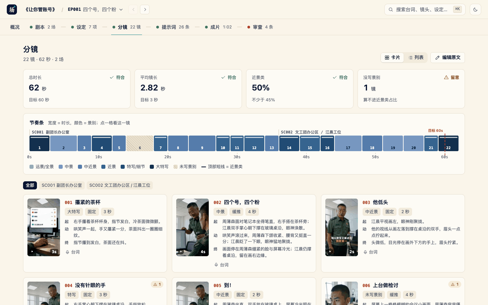

<!-- Last synced with README_EN.md: 2026-11-07 -->

<p align="center">
  
</p>

<h1 align="center">Drama Skills</h1>

<p align="center">
  <b>脚本家、モーションコミックのスタジオ、ディレクターのための AI ショートドラマ制作ワークフローです。12 個のスキルで、アイデアや原作小説から、エピソードの脚本、絵コンテ、画像・動画のプロンプト、完成した映像までを作ります。</b>
</p>

<p align="center">
  <a href="https://zenstory.ai/drama-skills"><b>プロジェクトページ</b></a>
  &nbsp;·&nbsp;
  <a href="#インストール"><b>インストール</b></a>
  &nbsp;·&nbsp;
  <a href="#何が出力されるか"><b>何が出力されるか</b></a>
  &nbsp;·&nbsp;
  <a href="README.md"><b>中文</b></a>
  &nbsp;·&nbsp;
  <a href="README_EN.md"><b>English</b></a>
</p>

<p align="center">
  <a href="https://github.com/zenstory-ai/drama-skills/stargazers"></a>
  <a href="https://github.com/zenstory-ai/drama-skills/releases/latest"></a>
  
  <a href="https://www.python.org/"></a>
  <a href="https://github.com/zenstory-ai/drama-skills/actions/workflows/ci.yml"></a>
  <a href="./LICENSE"></a>
</p>

<p align="center">
  <a href="https://t.me/+CZmsmvWIhb4zZTNl"></a>
</p>

https://github.com/user-attachments/assets/640db65d-bd57-4924-83de-9c5852c1db26

上の 68 秒の縦型サンプルは、『让你管账号』（Let You Run the Account）EP001 の冒頭です。20 章の小説を原作に、20 ショットの絵コンテに起こし、ショットごとに生成して 1 本の映像に編集し、編集の段階で字幕、システムパネル、効果音を加えました。動画の生成費用は約 ¥40 です。

### ほかのサンプル：格闘、群像シーン、2D の水墨画風コミック

https://github.com/user-attachments/assets/f67e2e04-52e7-42a9-a4a0-e2864ff0f51e

## これは何か

Drama Skills は、アイデアや小説から完成した映像まで、AI ショートドラマ / モーションコミックのパイプライン全体をカバーします。**原作の分析 → エピソードの脚本 → ビジュアル設定 → 画像プロンプトと絵コンテ → 動画プロンプト → 確認後の制作 → 編集 → レビュー** です。普段使っているコーディングエージェント（Claude Code、Codex、そのほか Agent Skill の仕様に対応したランタイム）に 12 個のスキルとしてインストールされ、文章を書くモデルはそのエージェントのモデルです。

- **5 つの Markdown ファイルが創作上の判断を記録します** — 各エピソードは、求められた段階のドキュメントを管理します。`剧本.md`（脚本）、`视觉设定.md`（ビジュアル設定）、`分镜.md`（絵コンテ）、`图片提示词.md`（画像プロンプト）、`视频提示词.md`（動画プロンプト）に加え、映像を編集する場合は `剪辑单.md`（編集リスト）です。これらのファイルが、それぞれの創作上の判断の正本になります。
- **ファイルにもとづく事実が、ショット間の連続性を保ちます** — ショットをまたいで保つべき見た目は 1 つのフレーズ（連続性ロック）として書かれ、影響を受けるすべてのプロンプトにそのまま貼り付けられます。どのキーフレームも視覚的な根拠を示します。チェッカーは宣言された参照と連続性ロックを検証します。実際のエラー出力を下に示します。
- **プレビューして、確認してから制作** — 画像、動画、音声、音楽のジョブは、まずこのバッチの正確な内容とパラメーターがファイルで示されます。外部の API が呼ばれ、お金がかかるのは、あなたが明示的に確認した後だけです。
- **編集もスイートの一部です** — 編集のスキルは、各イン点とアウト点をなぜそこに置いたかを書き残し、字幕を脚本からそのまま取り、ラウドネスを正規化してレンダリングします。チェックと計測のスクリプトは事実だけを報告し、良し悪しの判定はしません。

## 生まれた経緯

これらのスキルは、私たち自身のモーションコミックのスタジオの制作ラインから生まれました。2025 年以降、1,000 を超える AI ショートドラマとモーションコミックのプロジェクトを手がけ、何世代にもわたる社内とオープンソースのツールを使ってきました。フロントエンドとバックエンドを合わせると 8 万行近くに達し、モデルと要件が変わる速さについていけず、保守できなくなりました。

答えは、一体型のオールインワンの GUI をやめることでした。過去のプロジェクトのワークスペースと画像・動画のプロンプトをこのスキルスイートに凝縮し、制作者がエージェントの CLI を通じて、プレーンなファイルで直接プロジェクトを管理し、プロンプトを書き、生成に回す前にプロンプトを確認するようにしたのです。こちらのほうが明らかにうまくいきます。社内のツールで残っているのは、生成のキューだけです。

**確認は意図的に制作より前に置いています**：プロンプトはまずファイルに書かれます。制作のスキルは、正確な数、内容、参照、パラメーター、出力、アダプターを示し、ユーザーがそのプレビューを見て確認した後にだけ実行します。認証情報はプロジェクトの外に置かれ、プロジェクトのファイルとほかのスキルは特定のプロバイダーに依存しません。

## インストール

### GitHub からインストール

前提条件：Claude Code、Codex、または Agent Skill の仕様に対応したほかのコーディングエージェントをすでに使っていること。下のコマンドには、ターミナルで `npx`（Node.js）が必要です。

```bash
npx skills add zenstory-ai/drama-skills -y -g
```

`-g` を付けると、すべてのディレクトリで使えるようにグローバルにインストールされます。外すと、現在のディレクトリだけにインストールされます。**更新するには、同じコマンドをもう一度実行します**。スクリプトには **Python 3.9 以降**が必要です。まずインストールされているバージョンを確認してください。映像を編集するには、さらに PATH 上に `ffmpeg` / `ffprobe` が必要です。

エージェントにそのまま伝えることもできます（WorkBuddy など、GitHub のリポジトリやスキルをインポートできるプラットフォームであれば使えます。[コミュニティによる解説](https://zhuanlan.zhihu.com/p/2088046501696222384)（中国語）をご覧ください）。

```
Install this skill suite: https://github.com/zenstory-ai/drama-skills
```

<details>
<summary>Manual linking (install all skills or only the ones you need)</summary>

```bash
git clone https://github.com/zenstory-ai/drama-skills.git && cd drama-skills

# Claude Code
mkdir -p "$HOME/.claude/skills"
for skill in skills/*; do
  ln -s "$PWD/$skill" "$HOME/.claude/skills/$(basename "$skill")"
done

# Codex
mkdir -p "${CODEX_HOME:-$HOME/.codex}/skills"
for skill in skills/*; do
  ln -s "$PWD/$skill" "${CODEX_HOME:-$HOME/.codex}/skills/$(basename "$skill")"
done
```

各スキルは独立したインストールの単位です。脚本、レビュー、制作の機能を 1 つだけ使う場合は、そのディレクトリだけをリンクしてください。`short-drama` は、プロジェクトの初期化、ルーティング、Dashboard を提供します。

</details>

ClawHub のパッケージは[明示的な公開の一覧](.clawhub/publish.json)で管理されていて、[ClawHub](https://clawhub.ai/) から見つけられます。

呼び出し方はランタイムによって異なります。Claude Code は `/short-drama`、Codex は `$short-drama` を使います。接頭辞を省いて、普通の言葉でタスクを説明するだけでもかまいません。以下の例では `$` を使っています。Claude Code をお使いの方は、自分のランタイムに合わせて `/` を使ってください。

> 変更点は [CHANGELOG.md](CHANGELOG.md) と [Releases](https://github.com/zenstory-ai/drama-skills/releases) にあります。
> 既存のプロジェクトをアップグレードするときにすることは、FAQ の[アップグレードしたら何をすればいいですか？](#アップグレードしたら何をすればいいですか)にあります。

## クイックスタート

次の依頼のどれかをコピーし、詳細を調整して送ってください。

```
# 0. With a source novel (optional): triage before committing to a full pass
Use $short-drama-novel-analyze to triage 输入/novel.txt and tell me whether it is worth adapting

# With a complete multi-episode script (optional): infer this file's boundaries,
# read one episode at a time, and resume the episode map from disk
Use $short-drama-develop to build the episode map from 输入/full-screenplay.txt without loading the whole season into context

# 1. New project
Use $short-drama to init a vertical 9:16 urban face-slapping short-drama project

# 2. Write episode 1
Use $short-drama-write to write EP001: a delivery rider humiliated by the manager at a luxury restaurant reveals he is a director of the group

# 3. Extract assets, write prompts and storyboards (these can be one request)
Use $short-drama-assets to extract characters/scenes/props from EP001
When the visual language needs alignment, optionally use $short-drama for Look Development
Use $short-drama-image-prompts to write reference prompts for accepted assets
Use $short-drama-storyboard to author EP001's storyboard and frozen keyframes
Use $short-drama-video-prompts to translate each authored shot into a video prompt
# When you name a target model and need people/places/props consistent across shots, say so about references too:
Use $short-drama-video-prompts to write EP001's video prompts for MiniMax H3; first look through the project for existing character, location and prop images plus this shot's start frame and bind them as references, list whatever is still missing, and do not fall back to text-to-video
# When you make the reference images yourself and they never enter the project, ask for the attach plan instead:
Use $short-drama-video-prompts to write EP001's video prompts for MiniMax H3; I attach the reference images myself, so tell me per shot which pictures to attach, in what order, and what each one governs

# 4. Produce after explicit confirmation
Use $short-drama-produce to preview EP001's accepted image, video, TTS, or timeline-music job; execute only after I confirm

# 5. Cut the generated material into a film
Use $short-drama-edit to cut EP001's produced shots into a film, stating the reason behind every in and out point

# 6. Review when needed
Use $short-drama-review to review EP001's script and prompts
```

原作小説から始め、最初の作業をテキストでの引き渡しで止める場合：

> `输入/story.txt` を使ってください。これは私が所有しているか、翻案する権利を持っている作品です。まず、守るべき事実、登場人物の動機、まだ明かされていない情報を挙げ、そのうえでエピソードの分け方を提案してください。章の数をエピソードの数として扱わないでください。EP001 だけを書き、そのうちの 3 ショットを、開始と終了の動作、両手、持っている小道具、視線を付けて引き渡してください。`IMG-*`、保留中の `PLAN-*`、実際に確認した `REF-*` を区別してください。テキストで止め、画像、動画、音声、音楽は生成しないでください。

## 何が出力されるか

以下の抜粋は、このリポジトリのファイル、または 1 回の実際の実行から取ったもので、省略箇所は「…」で示しています。完全版（全体の作業と照らし合わせた原作の選別、翻案の契約、計測した編集、モデルの観察）は、[実際の出力の抜粋](docs/real-outputs_EN.md)にあります。

### エピソードはこうなります

公開サンプルの『[让你管账号』（Let You Run the Account）EP001](examples/creator-first/EP001/) では、同じショットを 4 つのドキュメントで 1 層ずつ担当しています。脚本は何が起きるかだけを書きます（翻訳）。

```markdown
[OS] Someone from another army unit: The Rocket Force? Four accounts, four followers between them, right?

Laughter pours out of the laptop's speaker. Behind the desk, Zhou Bosen sits bolt upright facing the screen, face set.
In front of it, Jiang Chen, palms on the desk edge, snaps back to himself.
```

`视觉设定.md`（ビジュアル設定）は、ショットをまたいで保つべき見た目に**連続性ロック**を与えます。そのロックのフレーズは、プロンプトにそのまま貼り付けられます（翻訳）。

```markdown
- Continuity lock: LOCK-JIANGCHEN-DRESS "Jiang Chen's pine-green service uniform" (shots: SHOT-EP001-002, SHOT-EP001-003, SHOT-EP001-007, …;
  image prompt entry: IMG-JIANGCHEN-SHEET) · lock phrase: pine-green lapel service jacket
```

`分镜.md`（絵コンテ）は、このショットの開始と終了、そしてカメラがなぜそう動くのかを書きます。凍結したキーフレームは開始のフレームだけを描き、その中にロックのフレーズを含めます（翻訳。プロンプトは書かれたとおりに引用しています）。

```markdown
## SHOT-EP001-002 · Four accounts, four followers
- Camera: slow push-in, starting at the loudest point of the laughter, past the back of the laptop toward the desk, stopping
  on Zhou Bosen's set face; the laughter is aimed at him.
- Start: Zhou Bosen sits bolt upright facing the laptop, right hand beside his tea tumbler; Jiang Chen's palms rest flat on
  the glass edge, his eyes unfocused.
- End: the frame settles on Zhou Bosen's set face in the screen glow; Jiang Chen still leans on the desk at the right edge.

### Frozen keyframe prompt
> 9:16 vertical two-person medium shot in a present-day army arts-troupe office, framed at chest height: Jiangchen, a lean
> young man in a pine-green lapel service jacket, stands mid-ground on frame right … with both palms flat on the glass and a
> dazed, unfocused look; Zhoubosen, a broad square-faced middle-aged officer, sits bolt upright behind the desk … facing a
> thin silver laptop whose lid faces the camera, … his right hand beside a double-walled glass tea tumbler on a dark round
> coaster; … no text, no logo.
```

`视频提示词.md`（動画プロンプト）は、開始から終了までの間にモデルが行う動作だけを書き、生成ツールに 1 つのブロックとして貼り付けられるようにします。

```markdown
## MOTION-EP001-002 · Four accounts, four followers
### Copyable prompt
> … Laughter keeps pouring out of the laptop's small speaker. The seated officer's jaw tightens and his back straightens a
> little more. The young man blinks once and his eyes snap into focus. At the loudest point of the laughter, the camera moves
> steadily forward past the back of the laptop and stops when the seated officer's tight face fills the middle of the frame,
> the young man remaining at the right edge. …
```

4 つの原本：[`剧本.md`](examples/creator-first/EP001/剧本.md) · [`视觉设定.md`](examples/creator-first/EP001/视觉设定.md) · [`分镜.md`](examples/creator-first/EP001/分镜.md) · [`视频提示词.md`](examples/creator-first/EP001/视频提示词.md)。

### 抜けは指摘されます

`creator_markdown_check.py` は、5 つのドキュメントの間の参照をチェックします。サンプルを意図的に 2 か所壊してみます。SHOT-002 の視覚的な根拠から周薄森を外し、MOTION-003 の長さを 2 秒から 3 秒に変えます。エラーは、影響を受けるショットと原因を特定します。

```text
ERROR: SHOT-EP001-002: 冻结关键帧提示词写到人物「周薄森」，视觉依据没有覆盖；本镜确实看不见时在视觉依据末尾加「；画外：人物「周薄森」」，正文里这个名字不可靠时在《视觉设定.md》写「画面代称：无」
ERROR: SHOT-EP001-003: 分镜时长 2 秒与视频提示词 3 秒不一致；视频提示词只能原样照抄已接受的镜头时长
```

1 行目：凍結したキーフレームが登場人物「周薄森」の名前を挙げているのに、視覚的な根拠がその人物をカバーしていません。本当に見えないのであれば、画面外と宣言します。2 行目：絵コンテでは 2 秒なのに、動画プロンプトでは 3 秒になっています。

## 12 個のスキル

依頼に必要な段階を使ってください。テキストでの引き渡しは目的の段階で止められ、レビューは既存のどの成果物にも使えます。静止画のモーションコミックは、キーフレームと音声から制作と編集に進みます。

```mermaid
flowchart LR
    classDef phase fill:#e8f4fd,color:#1a1a2e,stroke:#4a9be8,stroke-width:1px
    classDef final fill:#fce4ec,color:#333,stroke:#e57373,stroke-width:1px

    nva["Source analysis<br/>$short-drama-novel-analyze"]:::phase
    brk["Benchmark breakdown<br/>$short-drama-breakdown"]:::phase
    dev["Story development<br/>$short-drama-develop"]:::phase
    write["Episode script<br/>$short-drama-write"]:::phase
    assets["Asset decisions<br/>$short-drama-assets"]:::phase
    img["Image prompts<br/>$short-drama-image-prompts"]:::phase
    sb["Storyboard/keyframes<br/>$short-drama-storyboard"]:::phase
    vid["Video prompts<br/>$short-drama-video-prompts"]:::phase
    prod["Confirmed production<br/>$short-drama-produce"]:::phase
    cut["Editing<br/>$short-drama-edit"]:::phase
    rev["Review<br/>$short-drama-review"]:::final
    pkg["Text delivery package"]:::final

    nva -.with a source.-> dev
    brk -.with benchmarks.-> dev
    cut -.compare cuts.-> brk
    dev -.optional.-> write --> assets
    assets --> img
    assets --> sb --> vid
    img --> prod
    vid --> prod
    prod --> cut --> rev --> pkg
```



| スキル | 担当 |
|---|---|
| `short-drama` | 初期化、ルーティング、ビジュアルの方向性 / Look Development、Dashboard |
| `short-drama-novel-analyze` | 長い原作に対する、サンプリングによる翻案の選別、章の索引、章ごとの機能の抽出、物語の単位とリズム、翻案の価値、エピソードの候補 |
| `short-drama-develop` | 追跡できる翻案、複数エピソードの完全な脚本に対するエージェント主導の索引・分割・再開、物語のエンジン、エピソードの地図、ディレクターへのブリーフ、ジャンルとフックのプレイブック |
| `short-drama-write` | エピソードの契約、因果のビート、演じられる脚本、プロジェクトで受け入れた制作の方言 |
| `short-drama-assets` | キャラクター / ルック、ロケーション / ビュー、小道具 / 状態、任意の声のディレクション、連続性の判断 |
| `short-drama-image-prompts` | ルック開発のスタイルフレーム、再利用できるキャラクター・ロケーション・小道具の参照プロンプト、範囲を絞った編集 |
| `short-drama-storyboard` | 任意のシーンのビジュアルプランと Coverage Audition、原作のカバー、ショット、境界、凍結したキーフレーム |
| `short-drama-video-prompts` | 単一ショットの動作、複数の演者の演技と注目の受け渡し、カメラ、音、開始と終了の状態、撮り直しのメモ、ショットをまたぐタイムラインの音楽の仕様 |
| `short-drama-produce` | 範囲を限った画像・動画・TTS・音楽のジョブをプレビューし、明示的な確認を求め、外部のアダプターを実行して結果を記録します。Seedance、GPT Image 2、MiniMax H3 の動画、MiniMax Music の任意のプロファイルを同梱しています |
| `short-drama-edit` | 生成したクリップごとの使える範囲、イン点とアウト点とショットの順序、台詞の完全さ、字幕とラウドネス。編集リストとして書かれ、映像にレンダリングされます |
| `short-drama-breakdown` | お手本のドラマ（エピソードの長さ、ショットの長さ、台詞の密度、冒頭と結末）を計測して分解し、このプロジェクトの計画や映像と同じ物差しで比較し、それぞれの差を担当のスキルに渡して、生成した映像を再チェックします。1 つ以上のエピソードを、脚本、アセット、プロンプトに再構成することもできます |
| `short-drama-review` | 構造と内容のレビュー、許可された制作の観察にもとづくプロジェクトの範囲内での診断、修正の判定 |

## ローカルのクリエイターワークスペース

エージェントの中で 1 行入力します（Codex では `$short-drama dashboard` と書きます）。

```
/short-drama dashboard
```



macOS、Linux、WSL、ネイティブの Windows で動作します。`--detach` を付けると独立したプロセスで動くので、セッションの間ずっとリンクが有効です。`--status` でリンクを再表示し、`--stop` で停止します。ローカルのマシンでだけ待ち受け、プロジェクトの内容はアップロードされません。

すべて書き終えたら、引き渡します。`project_tool.py export <project> --out <dir outside the project>` は、各エピソードにある 5 つのクリエイター向けドキュメント、`剪辑单.md`、`制作成果/` を、マニフェストとチェックサム付きで 1 つの納品用ディレクトリにコピーします。テキストだけで引き渡す場合は `--no-media` を付けます。マニフェストには、足りないクリエイター向けドキュメントが一覧になります。

## FAQ

### MiniMax H3 のプロンプトは 6 段落あります。すべて貼り付けますか、それとも最初の段落だけですか？

すべてです。6 つの段落は **1 回で送信する 1 つのプロンプト本文**です。`retention_analysis` が参照する `<Subject N>` は `subject_definitions` で定義され、`<Picture N>` はこのショットの入力の参照の順に番号が振られるので、別々に送信すると後の段落は指す先がなくなります。`### 可复制提示词` の下の最初の行から最後の行までを、すべてその 1 回の生成に貼り付けてください。次のショットには、それ専用の完全な本文があります。[5 つのクリエイター向けドキュメント](skills/short-drama/references/creator-documents.md)と [MiniMax H3 の方言](skills/short-drama-video-prompts/references/minimax-h3.md)（中国語）をご覧ください。

### 参照画像は自分のツールで作っていて、プロジェクトに入れたくありません。それでも画像から動画へのプロンプトを作れますか？

はい、それがデフォルトです。プロジェクトに一致する画像がない場合、絵コンテはこのショットに必要な画像を `PLAN-*` の枠として書きます（`IMG-*` のボードか、このショットの `SHOT-*` の凍結したキーフレームで位置を示し、`order` は添付の順序で、どの画像も目的を記します）。動画プロンプトは通常どおり画像から動画への形式で作られ、ショットごとに、どの画像を、どの順序で添付し、それぞれが何を決めるのかを一覧にします。実際のファイルが必要になるのは、スイート自体がプロバイダーを呼び出すときだけです。`REF-*` は、プロジェクトに実際に存在し、確認済みの画像のためのものです。

### 対象の動画モデルを指定したのに、なぜテキストから動画へのプロンプトになったのですか？

モデルを指定することは、テキストから動画を選ぶことではありません。まずモデルが `short-drama.json` の `production_profile` に入り、次に絵コンテが、見えている登場人物、ロケーション、小道具、開始のフレームの既存の画像をプロジェクトの中から探して、目的付きの `REF-*` として結び付けます。まだ足りない画像はデフォルトで `PLAN-*` の枠になり、テキストから動画にフォールバックするのではなく、通常どおり画像から動画へのプロンプトが書かれます。[コミックドラマのワークフローガイド · よくあるつまずき](docs/comic-drama-workflow.md#常见卡点)（中国語）をご覧ください。

### H3 のクリップで台詞が早口になったり途切れたりします。どうすればいいですか？

ショットの長さを決める前に、絵コンテの段階で台詞の時間を見積もってください。H3 の中国語の小さなサンプルでは、自然なペースは 1 秒あたり約 4.1 文字の発声で、それより詰め込むと、黙って早口になったり途切れたりします。絵コンテは見積もりをショットの「音」の行に書き、台詞が収まらない場合はショットを長くするか分割します。動画プロンプトは、受け入れた長さをそのまま写すことしかできません。方法：[对白估时](skills/short-drama-storyboard/references/shot-craft.md#对白估时)（中国語）。

### A が話しているのに、B の顔で口が動きます

まず話者の結び付けを確認してください。小さなサンプルでは、口の動きが、より目立つ正面向きの顔に付いてしまうことがありました。話者が最初に登場するときは、`<d>` の外で、画面内か画面外かとその声を書き、台詞をその人物の動作の文の直後に置いてください。台詞の間に別の顔が正面を向いたままの場合は、その人物を口を閉じて話していないと明記し、絵コンテで許されるなら、先にフレームの外に出すか顔をそむけさせてください。[MiniMax H3 の方言 · 話者の結び付け](skills/short-drama-video-prompts/references/minimax-h3.md#说话人绑定)をご覧ください。小さなサンプルによるものなので、生成後にも確認してください。

### 動画のジョブを送信した後にプロセスが止まりました。送信し直しますか？

まず既存のジョブを回収してください。非同期の送信では、すでに料金が発生している可能性があります。同梱のアダプターは、プロバイダーのジョブ ID を受け取るとすぐにディスクに書き込みます。制作のスキルに `audit` を実行させると、ID を持つ未完了の試行が `orphaned_provider_job` として報告されるので、`collect` を使って、新しい生成を送信せずに回収してください。元のジョブが最終的に失敗し、回収できる結果が残っていないとわかってから、再試行をプレビューして確認してください。ポーリングやダウンロードの中断は、まず回収が必要です。[確認後の制作](skills/short-drama-produce/SKILL.md)（中国語）をご覧ください。

### GPU や自分のモデルは必要ですか？ 生成の費用は誰が払いますか？

GPU は不要です。脚本、絵コンテ、プロンプトは、すでに使っているコーディングエージェントのモデルが作ります。ローカルのスクリプトは、索引、検証、制作への引き渡し、編集のレンダリングを担当します。メディアの生成は `$short-drama-produce` の外部のアダプターを通じて行われ、プロジェクトの外で設定したプロバイダーの認証情報を使い、プロバイダーから請求されます。どのジョブもプレビューされ、あなたが明示的に確認した後にだけ実行されます。映像を編集するには、このマシンに `ffmpeg` / `ffprobe` が必要です。

### Codex で動きますか？ Windows では？

はい。Claude Code は `/short-drama`、Codex は `$short-drama` を使い、Agent Skill の仕様に対応したほかのランタイムはそれぞれの呼び出し方を使います。ワークスペースは macOS、Linux、WSL、ネイティブの Windows で動作します。CI では、インストール、エピソードの取り込み、ワークスペースのための Windows のジョブを別に実行しています。

### 静止画のモーションコミック（キーフレームの切り替えとナレーション）に動画プロンプトは必要ですか？

いいえ。絵コンテのキーフレームと画像プロンプトは、動画プロンプトの層を飛ばして、そのまま制作のプレビューに進みます。[コミックドラマのワークフローガイド](docs/comic-drama-workflow.md)（中国語）をご覧ください。

### アップグレードしたら何をすればいいですか？

同じインストールのコマンドをもう一度実行してください。既存のプロジェクトでは、エピソードごとに `creator_markdown_check.py` を 1 回実行すると、厳しくなったルールが表面化します（たとえば v0.7.0 以降は、絵コンテの「原作」の引用で名前が挙がっているのに視覚的な根拠になく、画面外とも宣言されていない登場人物や小道具が報告され、ショットと長さが違う動画プロンプトも報告されます）。厳しくなったドキュメントのルールの直し方は、[CHANGELOG.md](CHANGELOG.md) のアップグレードのメモに書かれています。編集済みのエピソードでは `edit_tool.py check` も実行してください。v0.7.1 以降は、使わなかったショットをそれぞれの ID と理由とともに一覧にする必要があり、「001 から 009」のような範囲の書き方は受け付けられなくなりました。

## さらに読む

- サンプル：[examples/](examples/)。公開しているクリエイター向けのサンプルは『[让你管账号』（Let You Run the Account）EP001](examples/creator-first/EP001/) です。そのほかの例のディレクトリは、バリデーターの回帰テスト用のフィクスチャです。
- [実際の出力の抜粋](docs/real-outputs_EN.md)：4 つのドキュメントを通した 1 つのショット、チェッカーのエラー、編集リストとその計測、原作の選別の振り返り、翻案の契約、モデルの観察。
- [評価](evaluations/README.md)（中国語）：ドキュメントに従って行った 1 回の実行の完全な出力、リリース前の回帰のゲート、メインのワークフローの実行方法。
- [オープンソースの AI ショートドラマのパイプライン](docs/open-source-short-drama-pipeline.md)：このパックが段階ごとに何をするか。
- [コミックドラマのワークフローガイド](docs/comic-drama-workflow.md)（中国語）：12 個のスキルを 1 本の制作ラインとして、ステップごとのコマンド、出力、よくある落とし穴とともに説明しています。
- [ショートドラマの脚本の形式のテンプレート](docs/short-drama-script-format-template.md)（中国語）：シーンの見出し、ト書き、台詞、制作のタグと、古い脚本を AI で整形し直した後に確認すること。
- [ショットをまたぐ一貫性](docs/character-consistency-across-shots.md)（中国語）：ショットとエピソードをまたぐキャラクターの一貫性と、三面図を超えたファイルの事実の 3 つの層。
- [小説からショートドラマへのガイド](https://zenstory.ai/drama-skills/novel-to-short-drama)：許可された原作から、エピソードの判断、1 本の脚本、最初の少数のショットまで。
- [キャラクターの一貫性のガイド](https://zenstory.ai/drama-skills/character-consistency)：キャラクターのアイデンティティ、このシーンに合う見た目、ショットごとの手・小道具・視線を分け、`IMG-*`、`PLAN-*`、`REF-*` を区別します。

## コミュニティ

- **Telegram**：<https://t.me/+CZmsmvWIhb4zZTNl> — 雑談、トラブルシューティング、ワークフローの共有、機能の議論。
- **GitHub Issues**：[バグ、出力の品質の事例、機能のリクエスト](https://github.com/zenstory-ai/drama-skills/issues/new/choose)。構造化されたフォームを使い、再現用の素材か具体的な出力を添付してください。

## コントリビュート

原則と必須のテストの実行については、[CONTRIBUTING.md](CONTRIBUTING.md)（中国語）をご覧ください。

<a href="https://github.com/zenstory-ai/drama-skills/graphs/contributors"></a>

## 謝辞

[LINUX DO - The New Ideal Community](https://linux.do) — コミュニティのサポート

## ZenStory AI の一部として

このプロジェクトは [ZenStory AI](https://zenstory.ai) が保守しています。物語を作り、翻案し、制作するための、オープンソースでエージェントネイティブなツールです（GitHub の組織：[zenstory-ai](https://github.com/zenstory-ai)）。姉妹プロジェクト：

| プロジェクト | 内容 |
| --- | --- |
| [oh-story-claudecode](https://github.com/zenstory-ai/oh-story-claudecode) | Web 小説の執筆のスキルパック：ランキングの調査、分解、下書き、AI っぽさの除去、表紙 |
| [drama-skills](https://github.com/zenstory-ai/drama-skills) | AI ショートドラマ / モーションコミックのスイート：脚本、アセット、絵コンテ、画像と動画のプロンプト、レビュー（このリポジトリ） |
| [novel-to-game](https://github.com/zenstory-ai/novel-to-game) | 原作にもとづく小説の翻案、対象のランタイムでのビルド、根拠にもとづく QA のためのエージェントスキル |
| [video-recap-skills](https://github.com/zenstory-ai/video-recap-skills) | 対応する動画ファイルから中国語ナレーションのまとめ動画を作ります。編集可能な JianYing/CapCut の下書きへの書き出しも任意でできます |
| [oh-story-dsh](https://github.com/zenstory-ai/oh-story-dsh) | 小説、ショートドラマ、ゲーム、動画のまとめのワークベンチを備えた、コミュニティによる DeepSeek Harness のプラグイン |
| [zenstory](https://github.com/zenstory-ai/zenstory) | チャットで創作する AI 小説執筆ワークベンチ（[app.zenstory.ai](https://app.zenstory.ai)） |
